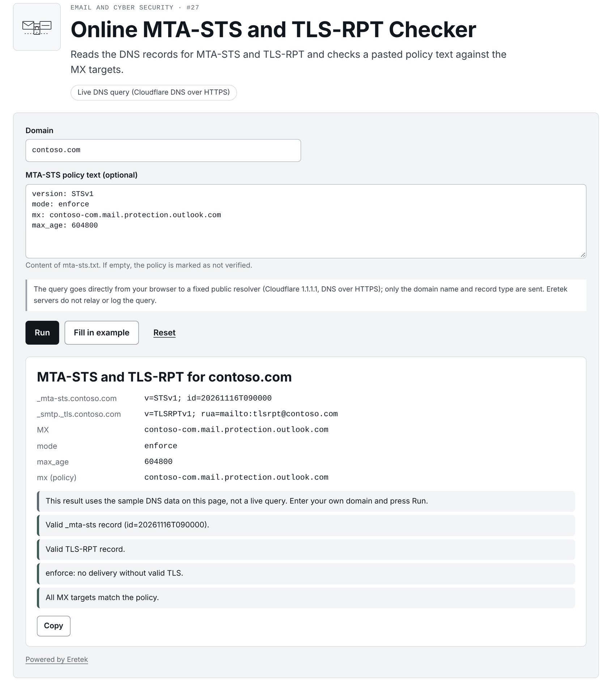

# MTA-STS and TLS-RPT Checker

Check the _mta-sts and _smtp._tls DNS records and compare a pasted MTA-STS policy text with your MX records. The policy file is not fetched automatically.

## Try it live

- [Türkçe](https://siberguvenlik.eretek.com/araclar/mta-sts-tls-rpt-kontrolu)
- [English](https://siberguvenlik.eretek.com/en/tools/mta-sts-tls-rpt-checker)
- [Deutsch](https://siberguvenlik.eretek.com/de/werkzeuge/mta-sts-tls-rpt-pruefung)



## What it does

Reads the DNS records for MTA-STS and TLS-RPT and checks a pasted policy text against the MX targets.

MTA-STS (RFC 8461) tells sending servers to deliver mail to your domain only over TLS with a valid certificate; TLS-RPT (RFC 8460) has TLS problems during delivery reported. The setup has two parts: TXT records in DNS and the policy file at `https://mta-sts.domain/.well-known/mta-sts.txt`.

The tool queries the DNS records live. It does not download the policy file itself, because that would mean Eretek sending a request to your server. If you open the file in your browser and paste its content, the MX match is checked.

## Where it helps

If an MX target is missing from the policy, delivery to it fails in enforce mode; update the policy first, then change the id.

With Microsoft 365 you can use `*.mail.protection.outlook.com` as the mx line.

## How to use it

1. Enter the domain.
2. Optionally open `https://mta-sts./.well-known/mta-sts.txt` in your own browser and paste its content into the policy field.
3. Press Run.

### Fields

| Field | Description |
|---|---|
| Domain |  |
| MTA-STS policy text (optional) | Content of mta-sts.txt. If empty, the policy is marked as not verified. |

## Example input

Press **Fill in example** in the tool to load this input.

| Input | Value |
|---|---|
| Domain | `contoso.com` |

**MTA-STS policy text (optional)**

```text
version: STSv1
mode: enforce
mx: contoso-com.mail.protection.outlook.com
max_age: 604800
```

**Expected result:** _mta-sts TXT (id=20261116T090000) and _smtp._tls TXT exist; the policy is in enforce mode and covers the MX target.

## Method and assumptions

`v=STSv1` and `id` are expected in `_mta-sts.domain` TXT, `v=TLSRPTv1` and `rua` (mailto: or https:) in `_smtp._tls.domain` TXT; each must be a single record.

In the pasted policy, version, mode (enforce/testing/none), max_age (at most 31,557,600 s) and mx lines are read. Each MX target must match an mx pattern (exact name or wildcard in the leftmost label).

## Limits and common mistakes

- The policy file is not fetched; its HTTPS certificate and availability are not verified.
- Whether senders have cached the policy is not visible.

## Run it locally

The tool is plain HTML, CSS and JavaScript with no build step and no dependencies.

```bash
git clone https://github.com/eretek/mta-sts-tls-rpt-checker.git
cd mta-sts-tls-rpt-checker
node scripts/serve.js        # or: python3 -m http.server 8080
```

Open <http://127.0.0.1:8080/>. Add `?lang=tr` or `?lang=de` for Turkish or German; without it the page follows the browser language and falls back to English. You can also open `index.html` directly from disk.

Run the tests (Node.js 18 or later):

```bash
node test/run.js    # or: npm test
```

The tests run the tool's own fixtures and the worked examples in all three languages without a browser.

## How it works

Everything except the DNS lookup runs in your browser. The lookup goes directly from the browser to a fixed public DNS-over-HTTPS resolver (Cloudflare `cloudflare-dns.com`, with Google `dns.google` as the second resolver in `src/lib/dns.js`); only the domain name and record type are sent. The **Fill in example** button uses sample DNS data stored in `src/data.js`, not a live query.

No server-side component is needed. The version on the Eretek website renders the same page through a private WordPress plugin; that plugin only produces the page markup and is not part of this repository.

| Path | Purpose |
|---|---|
| `index.html` | Page shell |
| `src/app.js` | Builds the page in Turkish, English or German from `src/data.js` |
| `src/data.js` | Field definitions, examples and all texts in three languages |
| `src/core.js` | Shared runtime: validation, number formats, result rendering, CSV/ICS export |
| `src/tool.js` | The calculation or analysis for this tool |
| `docs/screenshot.png` | Screenshot used in this README |
| `src/lib/dns.js` | DNS-over-HTTPS client for fixed public resolvers |
| `src/tools.css`, `src/page.css` | Styles |
| `test/run.js`, `test/cases.json` | Headless tests |

## License and attribution

This tool is released under the [Eretek Website Attribution License](LICENSE). You may use, modify and redistribute it, including commercially. If you make it available on a website or web application, show a visible, clickable credit linking to https://eretek.com/ on every page where the tool is available, for example:

```html
<a href="https://eretek.com/">Powered by Eretek</a>
```

You may add `rel="nofollow"` to the link. Keep the copyright notice and license text in copies and redistributions.
